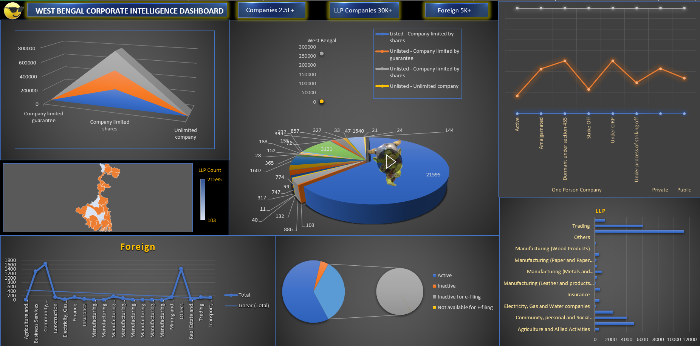

# West Bengal Corporate Intelligence Dashboard

An Excel-based Data Analytics project exploring the corporate landscape of West Bengal using official Ministry of Corporate Affairs (MCA) data.
## 📥 Download Project

**[Download Excel Dashboard (.xlsm)](https://drive.google.com/file/d/1jWW7bMi1XBnKCVqibgrLjBb6vBYf1B6t/view?usp=sharing)**

## 📊 Dashboard Preview

## 📄 View Project Documentation (PDF)

## 📌 Project Overview

This project analyses company registrations, LLPs, industry distribution, corporate status, capital information, and geographical distribution across West Bengal.

It transforms raw government datasets into meaningful insights through data cleaning, analysis, PivotTables, and an interactive Excel dashboard.

**Project Type:** Data Analytics  
**Tool:** Microsoft Excel 2021  
**Domain:** Corporate & Business Intelligence  
**Data Source:** MCA Corporate Data Management Portal

## 🎯 Problem Statement

Raw corporate datasets contain large volumes of information that are difficult to interpret directly. The objective was to organize and analyse these datasets to understand business registrations, industry patterns, geographical concentration, and corporate status in West Bengal.

## 📂 Dataset Overview

| Dataset | Records | Columns |
|---|---:|---:|
| Company Master | 263,295 | 15 |
| LLP Master | 33,932 | 9 |
| Foreign Company Master | 5,385 | 7 |
| **Total** | **302,612** | — |

*Company and LLP datasets are West Bengal-specific. Foreign Company Master is India-wide.*

## 🧹 Data Cleaning & Preparation

- Removed blank rows and duplicate records.
- Standardized date and text formats.
- Cleaned address and PIN code fields.
- Standardized district names.
- Handled missing values and data errors.
- Used Power Query and Excel formulas for data preparation.

## 📊 Analysis Performed

**Company Analysis**
- Company classification and registration trends.
- Industry-wise distribution.
- Active and inactive company status.
- Authorized and paid-up capital analysis.

**LLP Analysis**
- Year-wise registration trends.
- District-wise distribution.
- Industry classification.
- LLP status analysis.

**Foreign Company Analysis**
- Country-wise distribution.
- Industry classification and company status.
- Address-based identification of West Bengal records.

## 🚧 Challenges & Solutions

| Challenges | Solutions |
|---|---|
| Dates appearing as null in Power Query | Corrected data types and date conversion. |
| Duplicate and missing records | Applied data quality checks. |
| Inconsistent district names | Standardized verified district variations. |
| PIN code formatting issues | Preserved PIN codes in text format. |
| Large workbook size | Separated raw, cleaned, and analysis sheets. |
| Dynamic KPI issues with slicers | Used helper PivotTables and GETPIVOTDATA. |
| District map recognition issues | Improved geographical labels and location context. |

## 📈 Key Findings

- Private companies form the largest company classification, with 238,999 records.
- Kolkata has the highest recorded LLP concentration, with 21,595 records.
- North 24 Parganas and South 24 Parganas are also major LLP concentration areas.
- LLP registrations show changing patterns across the available years.
- The 2026 LLP extract contains 4,753 records and represents a partial-year dataset.

## 📊 Dashboard Features

- Interactive KPI cards.
- Company and LLP registration analysis.
- Industry-wise and district-wise visualizations.
- Company and LLP status analysis.
- Foreign company summaries.
- PivotCharts and interactive slicers.

## 🛠️ Tools & Technologies

- Microsoft Excel 2021
- Power Query
- PivotTables & PivotCharts
- Excel Formulas and Functions
- Data Cleaning & Validation
- Data Visualization

## ⚠️ Project Limitations

- Foreign Company Master contains India-wide records, not exclusively West Bengal records.
- Foreign Company Master does not contain registration dates.
- 2026 LLP records represent a partial extract.
- Some district assignments require address verification.

## 🏁 Final Outcome

Developed an end-to-end Excel analytics solution that converts raw MCA corporate data into structured analysis and an interactive dashboard. The project demonstrates practical skills in data cleaning, transformation, exploratory analysis, visualization, and business insights.
